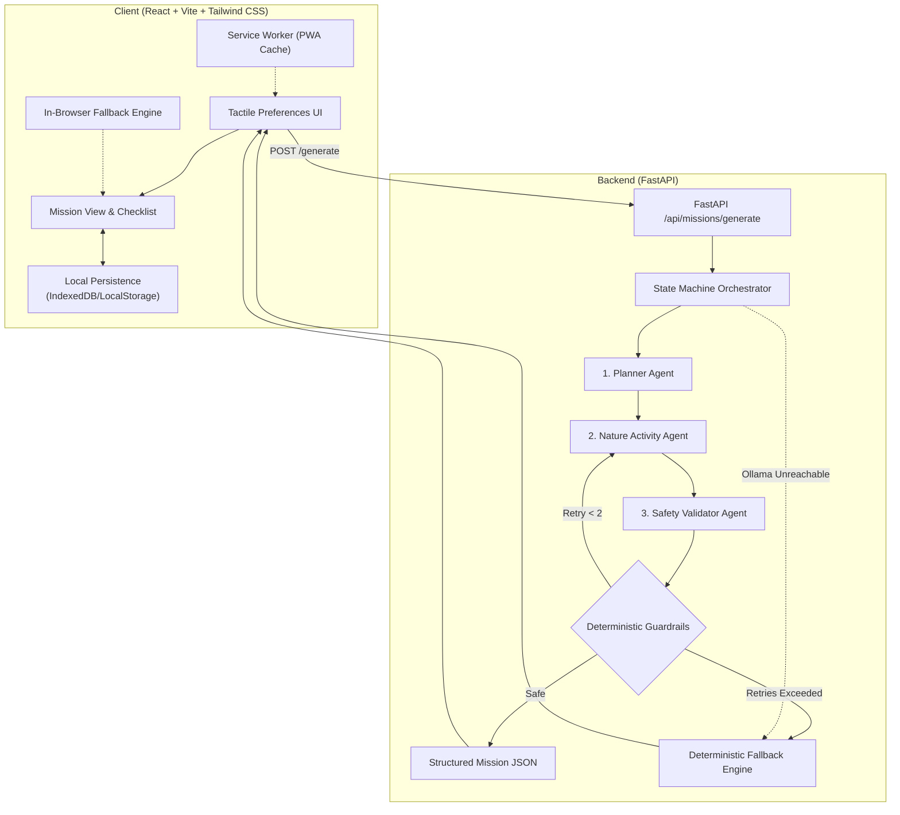

# GreenQuest 🌲

> **Personalized outdoor micro-adventures using open-weight AI.**  
> *Hacktoberfest 2026 Open-Source AI Challenge Submission*

[](https://github.com/greenquest/greenquest/actions)
[](LICENSE)
[](https://www.python.org/)
[](https://react.dev/)
[](https://web.dev/progressive-web-apps/)

---

## 🍃 Project Vision & Philosophy

Modern screens command too much of our attention. **GreenQuest** is a mobile-first, offline-capable Progressive Web App (PWA) designed to get people **off** their devices and **into** local parks, community gardens, trails, waterfronts, and neighborhoods.

Users enter simple preferences (environment, time available, mood, energy level, companion, sensory focus). GreenQuest then generates a structured, bite-sized micro-adventure (15–60 minutes) featuring sensory prompts, tactile exploration steps, and leave-no-trace stewardship principles.

Once loaded, the entire application works **100% offline**:
- Assets are cached by a Service Worker.
- Missions, checklists, and completion history persist locally in browser storage.
- A dual-layer deterministic procedural fallback engine creates authentic quests even when AI servers or internet connections are completely unavailable.

---

## 🎨 Visual Identity

GreenQuest rejects generic AI dashboard aesthetics in favor of a calm, grounded nature companion:
- **Deep Forest Green** (`#1b382b`): Grounding foundation, header, and primary actions.
- **Warm Cream** (`#fbf8f1`): Soothing daylight background, paper-textured card surfaces.
- **Muted Sage** (`#8ea893`): Subtle botanical accents, borders, and calm sensory tags.
- **Restrained Amber** (`#d97736`): Sunlit highlights, active step indicators, and energy tags.
- Large tactile controls and high-contrast typography optimized for outdoor mobile use under bright sunlight.

---

## 🏛 Architecture & Tech Stack



- **Frontend**: React 18, TypeScript, Vite, Tailwind CSS, Lucide Icons, Service Worker PWA.
- **Backend**: Python 3.11+, FastAPI, Pydantic v2, Pydantic-Settings, HTTPX, Pytest.
- **Local Inference Target**: Ollama with `gemma3:1b` (optimized for 16 GB RAM laptops with integrated graphics; no GPU needed).
- **Optional Hosted Inference**: OpenAI-compatible adapter for hosted open-weight models.
- **Deterministic Safeguards**: Zero-trust rule engine enforcing foraging bans, trespassing bans, water/cliff hazard filters, and Leave-No-Trace principles.
- **Deployment**: Render Blueprint (`render.yaml`).

---

## 🚀 Quickstart & Local Setup

### Prerequisites
- **Python 3.11+**
- **Node.js 20+** and **npm**
- *(Optional for AI inference)*: [Ollama](https://ollama.ai) installed with `gemma3:1b` (`ollama pull gemma3:1b`). If Ollama is not installed or running, GreenQuest seamlessly activates its deterministic fallback engine.

### 1. Clone & Configure
```bash
git clone https://github.com/greenquest/greenquest.git
cd greenquest
cp .env.example .env
```

### 2. Start Backend API
```bash
# Install backend dependencies
pip install -r requirements.txt

# Start FastAPI server with hot-reload
python3 -m uvicorn backend.app.main:app --host 0.0.0.0 --port 8000 --reload
```
API Documentation will be live at: `http://localhost:8000/docs`

### 3. Start Frontend PWA
In a new terminal:
```bash
cd frontend
npm install
npm run dev
```
Open your browser at `http://localhost:5173`.

---

## 🧪 Automated Testing & Verification

GreenQuest includes an automated test suite verifying schemas, safety rules, providers, and API contracts.

### Run Backend Test Suite
```bash
python3 -m pytest -v backend/tests
```
**Results Verified (25/25 passing)**:
- `test_schemas.py`: Preference request bounds, sensory deduplication, step validation, serialization.
- `test_safety_rules.py`: Foraging/ingestion rejection, trespassing filter, hazardous water/cliff bans, wildlife harassment filter, leave-no-trace enforcement.
- `test_providers.py`: Deterministic fallback generator across all environments, Ollama unreachable handling, Hosted unconfigured handling.
- `test_orchestrator.py`: State machine execution, bounded retry loop, remediation injection, automated fallback triggers.
- `test_api.py`: FastAPI `/api/health`, `/api/providers`, `/api/missions/sample`, and `/api/missions/generate`.

### Build & Verify Frontend PWA
```bash
cd frontend
npm run build
```
Compiles TypeScript with strict type checking and produces optimized static assets in `frontend/dist`.

---

## 🛡 Deterministic Safety Rules

LLMs are creative generators, not safety authorities. All outputs pass deterministic validation filters:
1. **Zero Wild Ingestion**: Strictly prohibits eating, chewing, or tasting berries, plants, mushrooms, fungi, or unpurified water.
2. **Zero Trespassing**: Prohibits private land entry, climbing fences, or wandering off public recreational paths.
3. **Terrain & Water Guard**: Rejects cliff edges, steep ascents, fast-flowing river crossings, and hazardous tree climbs.
4. **Wildlife Protection**: Prohibits touching, chasing, cornering, or feeding wild animals.
5. **Leave-No-Trace**: Enforces environmental stewardship principles in every mission.

---

## ☁️ Deployment (Render)

GreenQuest includes a `render.yaml` blueprint for one-click deployment:
- **Backend**: FastAPI web service running on Python.
- **Frontend**: Static site serving the Vite PWA bundle with service worker routing.

---

## 📋 Hacktoberfest 2026 Checklist & Roadmap

- [x] Architecture design and API contracts (`docs/ARCHITECTURE.md`)
- [x] Deterministic safety guardrail engine (`backend/app/orchestrator/rules.py`)
- [x] Model-provider abstraction layer (`backend/app/providers/`)
- [x] Ollama integration for Gemma 3 1B with connection timeouts
- [x] Dual-layer deterministic fallback engine (backend + frontend in-browser)
- [x] State machine orchestrator with typed agents and bounded retries
- [x] Mobile-first React PWA with earth-toned design tokens
- [x] Step checklist with local storage persistence
- [x] Service worker offline asset caching (`sw.js`)
- [x] Comprehensive automated test suite (25 tests passing)
- [x] GitHub Actions automated CI (`.github/workflows/test.yml`)
- [ ] *Next Task*: Real-world outdoor hardware testing with local Ollama daemon and Gemma 3 1B / 4B latency benchmarking.

---

## 📄 License
MIT License. Built with care for Hacktoberfest 2026 Open-Source AI Challenge.
