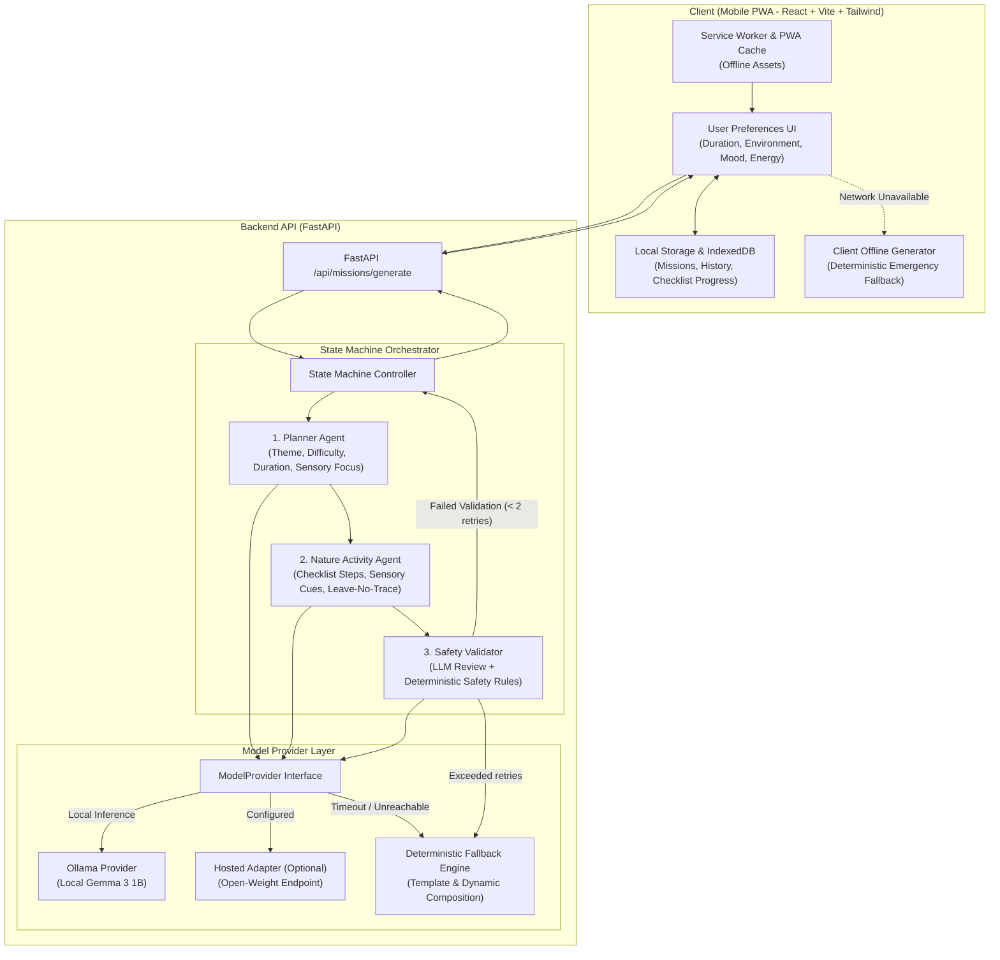
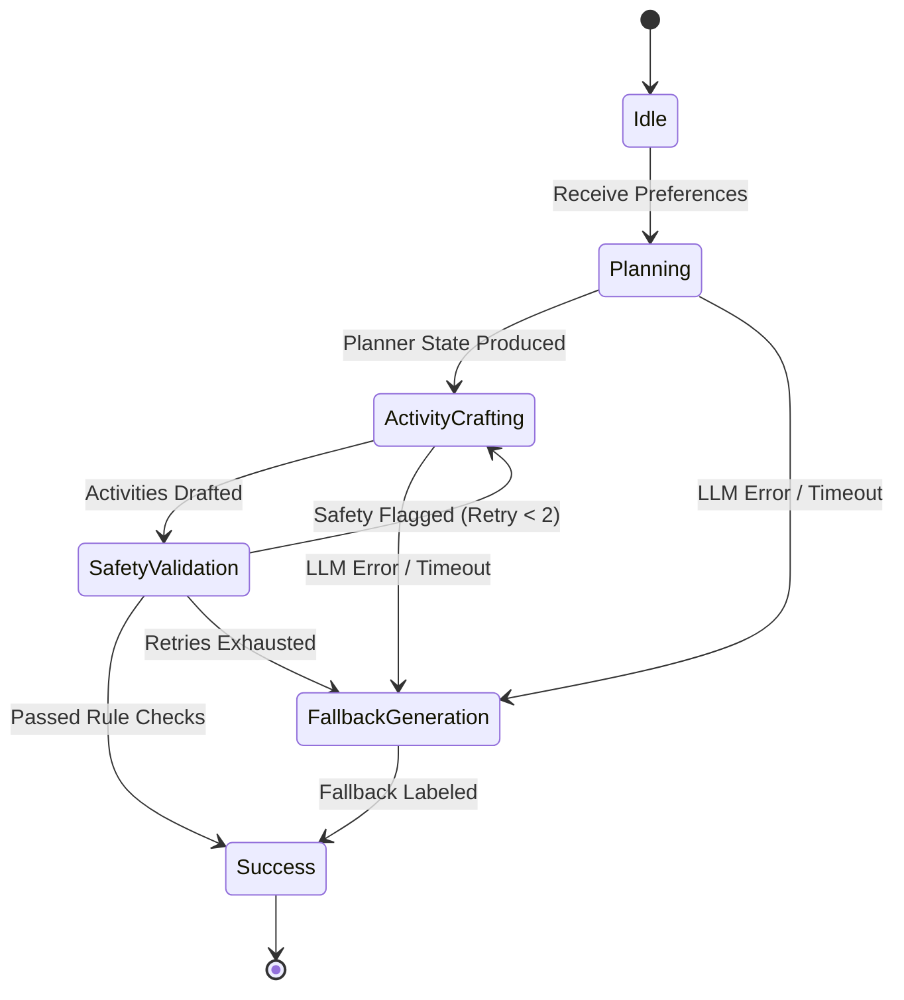

# GreenQuest Architecture Document
**Hacktoberfest 2026 Open-Source AI Challenge**
*Submission Target: October 11, 2026 | Visual Identity: Forest Green & Warm Cream Nature Companion*

---

## 1. Executive Summary & Design Philosophy

**GreenQuest** is an offline-capable, mobile-first Progressive Web App (PWA) designed to get people *off* their screens and *into* nature through personalized, sensory-rich micro-adventures.

Instead of keeping users tethered to a digital device, GreenQuest generates structured, bite-sized quests (15–60 minutes) for parks, community gardens, trails, and urban green spaces. Once generated, missions are fully stored locally, with step-by-step nature checklists, sensory prompts, and ecological stewardship tips that can be completed without active connectivity.

### Core Architecture Tenets
1. **Low-Resource & Open-Weight First**: Runs locally on a 16 GB RAM integrated graphics laptop using Ollama with `gemma3:1b`. No GPU required.
2. **Deterministic Safety Guardrails**: LLMs are creative generators, not safety authorities. All outputs pass deterministic validation filters before reaching the user.
3. **Resilient Offline-First Strategy**: Dual-tier fallback (server-side rule generator + frontend embedded generator) ensures complete functionality when offline or when inference servers are unreachable.
4. **Observable State-Machine Orchestrator**: Explicit typed agents (Planner, Nature Activity, Safety Validator) with bounded retry loops and traceable execution logs.
5. **Calm Nature Companion Aesthetic**: Deep forest green (`#1b382b`), warm cream (`#fbf8f1`), muted sage (`#8ea893`), and restrained amber (`#d97736`).

---

## 2. System Architecture Diagram



---

## 3. Directory Layout

```
greenquest/
├── .github/
│   └── workflows/
│       └── test.yml                  # Automated CI test workflow
├── backend/
│   ├── app/
│   │   ├── __init__.py
│   │   ├── main.py                   # FastAPI entrypoint, middleware, CORS
│   │   ├── config.py                 # Pydantic Settings & environment variables
│   │   ├── models/
│   │   │   ├── __init__.py
│   │   │   ├── mission.py            # Mission, Step, Preference, SafetyReview models
│   │   │   └── provider.py           # Provider LLM request/response types
│   │   ├── providers/
│   │   │   ├── __init__.py
│   │   │   ├── base.py               # Abstract Base Class for LLM providers
│   │   │   ├── ollama.py             # Ollama HTTP client (Gemma 3 1B default)
│   │   │   ├── hosted.py             # Optional hosted open-weight adapter
│   │   │   └── fallback.py           # Deterministic offline/error fallback generator
│   │   ├── orchestrator/
│   │   │   ├── __init__.py
│   │   │   ├── state.py              # Orchestrator state dataclass & logs
│   │   │   ├── machine.py            # State machine with bounded retry logic
│   │   │   ├── repair.py             # Open-weight JSON recovery & sanitation
│   │   │   ├── rules.py              # Deterministic safety rule checks
│   │   │   └── agents/
│   │   │       ├── __init__.py
│   │   │       ├── planner.py        # Planner agent prompt & parser
│   │   │       ├── nature_activity.py# Nature activity & sensory prompt builder
│   │   │       └── safety.py         # Safety agent & validator integration
│   │   └── api/
│   │       ├── __init__.py
│   │       └── routes.py             # REST API routes (/generate, /health, /providers)
│   └── tests/
│       ├── test_schemas.py           # Pydantic models & validation
│       ├── test_safety_rules.py      # Deterministic safety blacklist & limits
│       ├── test_providers.py         # Provider interface & fallback engine
│       ├── test_orchestrator.py      # State machine steps & retry logic
│       ├── test_regression_ollama.py # Regression tests for Gemma 3 1B JSON repair & Ollama integration
│       └── test_api.py               # FastAPI endpoints & error responses
├── frontend/
│   ├── public/
│   │   ├── favicon.svg               # Pine needle / leaf icon
│   │   ├── manifest.json             # PWA Web App Manifest
│   │   └── sw.js                     # Cache-first service worker
│   ├── src/
│   │   ├── components/
│   │   │   ├── Header.tsx            # Nature companion header & connectivity badge
│   │   │   ├── PreferenceForm.tsx    # Tactile environment & energy controls
│   │   │   ├── MissionCard.tsx       # Mission details & sensory focus
│   │   │   ├── MissionChecklist.tsx  # Interactive checkbox list with local sync
│   │   │   ├── SafetyNotice.tsx      # Leave-no-trace & caution callouts
│   │   │   └── HistoryDrawer.tsx     # Offline saved adventures & progress
│   │   ├── services/
│   │   │   ├── api.ts                # API client with timeout & offline switch
│   │   │   ├── storage.ts            # IndexedDB/LocalStorage persistence
│   │   │   └── fallbackMissions.ts   # In-browser deterministic fallback missions
│   │   ├── types/
│   │   │   └── mission.ts            # Frontend TypeScript types
│   │   ├── styles/
│   │   │   └── index.css             # Tailwind utilities & earth-toned design tokens
│   │   ├── App.tsx                   # Main vertical slice layout
│   │   └── main.tsx                  # PWA bootstrap
│   ├── index.html
│   ├── vite.config.ts
│   ├── tsconfig.json
│   ├── tailwind.config.js
│   ├── postcss.config.js
│   └── package.json
├── docs/
│   ├── ARCHITECTURE.md               # This document
│   └── CHECKLIST.md                  # Hacktoberfest 2026 progress tracking
├── .env.example                      # Configuration reference
├── .gitignore                        # Git exclusion rules
├── README.md                         # Project overview, installation, usage
├── render.yaml                       # Render blueprint for one-click deployment
└── requirements.txt                  # Python dependencies
```

---

## 4. API Contracts

### `POST /api/missions/generate`
Generates a structured micro-adventure based on user preferences.

#### Request Body (`MissionPreferenceRequest`)
```json
{
  "duration_minutes": 30,
  "environment": "park",
  "mood": "mindful",
  "energy_level": "moderate",
  "companion_type": "solo",
  "sensory_focus": ["sight", "sound"],
  "notes": "Near community duck pond"
}
```

*Fields*:
- `duration_minutes`: Integer (10 to 120, default 30)
- `environment`: Enum (`"park"`, `"forest"`, `"neighborhood"`, `"garden"`, `"waterfront"`, `"trail"`)
- `mood`: Enum (`"mindful"`, `"curious"`, `"playful"`, `"contemplative"`, `"energized"`)
- `energy_level`: Enum (`"low"`, `"moderate"`, `"brisk"`)
- `companion_type`: Enum (`"solo"`, `"family"`, `"friends"`, `"dog"`)
- `sensory_focus`: Array of strings (`"sight"`, `"sound"`, `"touch"`, `"scent"`, `"spatial"`)
- `notes`: Optional string (max 140 chars)

#### Response Body (`MissionResponse`)
```json
{
  "id": "gq-20261011-park-mindful-a82f",
  "title": "Whispers of the Canopy: Pondside Mindfulness",
  "tagline": "Notice five shades of green and listen for water ripples.",
  "environment": "park",
  "estimated_duration_minutes": 30,
  "difficulty": "easy",
  "theme": "Sensory Botanicals & Water Reflection",
  "sensory_prompt": "Tune into sound before opening your eyes to examine leaf veins.",
  "leave_no_trace_principle": "Stay on marked trails and avoid trampling shoreline reeds.",
  "safety_notes": [
    "Stay on established public pathways.",
    "Do not touch unfamiliar berries or ingest any plant material.",
    "Keep personal safety awareness when crossing paths."
  ],
  "steps": [
    {
      "step_number": 1,
      "title": "Grounding in Stillness",
      "instruction": "Stand quietly by the edge of the walking trail for 2 minutes. Close your eyes and identify 3 distinct natural sounds.",
      "sensory_type": "sound",
      "estimated_minutes": 5,
      "completed": false
    },
    {
      "step_number": 2,
      "title": "Leaf Architecture Search",
      "instruction": "Find two fallen leaves with different edge patterns (e.g. serrated vs. smooth). Trace their leaf veins with your thumb without picking living leaves.",
      "sensory_type": "touch",
      "estimated_minutes": 10,
      "completed": false
    },
    {
      "step_number": 3,
      "title": "Canopy Gradient Observation",
      "instruction": "Look up into the tree branches. Spot at least four gradations of green from sunlight to shadow.",
      "sensory_type": "sight",
      "estimated_minutes": 10,
      "completed": false
    },
    {
      "step_number": 4,
      "title": "Nature Gratitude Reflection",
      "instruction": "Take three deep breaths of fresh outdoor air. Note one natural element you appreciate before departing.",
      "sensory_type": "scent",
      "estimated_minutes": 5,
      "completed": false
    }
  ],
  "generator_info": {
    "provider": "ollama",
    "model": "gemma3:1b",
    "fallback_used": false,
    "generation_time_ms": 1420,
    "safety_validated": true
  },
  "created_at": "2026-10-11T13:30:00Z"
}
```

### `GET /api/health`
Health check endpoint reporting system uptime, provider availability, and fallback readiness.

---

## 5. Model Provider Architecture

The `ModelProvider` abstract base class decouples the application from any single AI runtime:

```python
class ModelProvider(ABC):
    @abstractmethod
    async def generate_completion(self, prompt: str, system_prompt: str, json_mode: bool = True) -> str:
        """Execute text completion with model."""
        pass

    @abstractmethod
    async def check_availability(self) -> ProviderStatus:
        """Check if provider backend is reachable and ready."""
        pass
```

- **`OllamaProvider` (Primary target)**: Connects to `http://localhost:11434/api/generate` with timeout bounds (default 25s). Uses `gemma3:1b` (low VRAM and low RAM footprint suitable for 16 GB laptop).
- **`HostedProvider` (Optional adapter)**: Minimal HTTP adapter for standard open-weight inference endpoints.
- **`DeterministicFallbackProvider` (Guaranteed fallback)**: Template and procedural generator that creates realistic, diverse micro-adventures matching all schema constraints without external dependencies.

---

## 6. Orchestrator State Machine & Safety Validation



### Deterministic Safety Rules
LLM output is never trusted blindly. The `SafetyEngine` validates:
1. **Private Property / Trespassing Guard**: Rejects actions urging off-trail trespassing, climbing fences, entering restricted grounds.
2. **Water / Cliff / Hazard Filter**: Rejects high-risk actions near turbulent water, unstable cliffs, or electrical hazards.
3. **Foraging & Ingestion Ban**: Strictly bans eating wild mushrooms, plants, berries, or drinking untreated water.
4. **Wildlife Interaction Prohibition**: Enforces observing from safe distances; bans feeding or handling animals.
5. **Night / Extreme Weather Caution**: Enforces day-lit paths, flashlights, and weather awareness.
6. **Leave-No-Trace Enforcement**: Ensures every mission includes a leave-no-trace reminder.

---

## 7. Offline Strategy & Local Persistence

1. **PWA Service Worker**: Static bundle (HTML, CSS, JS, SVG assets) cached via Cache Storage on first load.
2. **Mission Storage**: All generated missions stored in browser `localStorage` / `IndexedDB` with unique IDs, completion timestamps, and step checkbox states.
3. **Emergency Client-Side Generator**: If the device has no internet connection and the local FastAPI server is not running, the frontend automatically generates full micro-adventures from client-side procedural templates.

